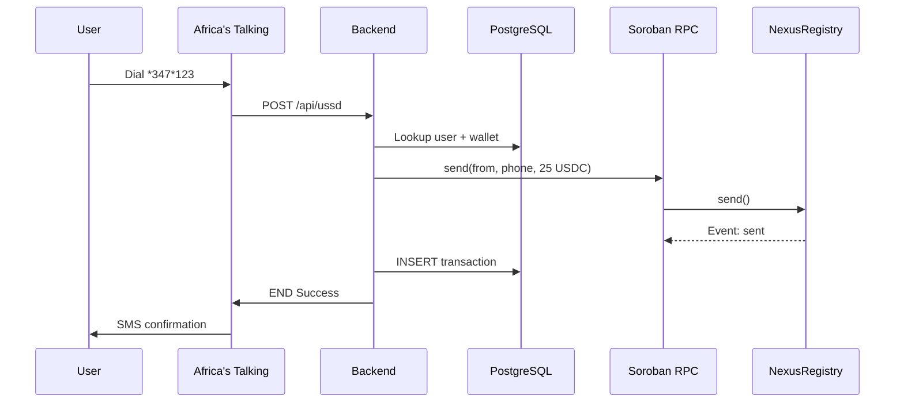

# Nexus — Open Issues

22 tracked issues organised by area. Each issue includes a title, description,
reproduction steps (for bugs), acceptance criteria, files involved, and
suggested approach.

---

## Bug Reports

### 1. USSD session store leaks stale sessions after Africa's Talking timeout

**Labels:** `bug`, `backend`  
**Priority:** high

Africa's Talking terminates a USSD session after 20 seconds of idle time.
The Nexus backend keeps the session in its `Map<string, UssdSession>` in
`routes/ussd.ts` indefinitely. When the same phone dials back, the stale
session is picked up instead of starting fresh at the menu. This means a
user who abandoned a half-finished "Send Money" flow yesterday returns to
"Enter amount" instead of "Welcome to Nexus" on their next dial.

The issue is compounded by the fact that the session map grows unboundedly
— in production every unique phone number that ever dials accumulates an
entry that is never garbage-collected.

**Steps to reproduce:**
1. Dial `*347*123#` and reach the Nexus menu
2. Select "1. Send Money"
3. Wait 25 seconds (AT timeout window)
4. Dial again — observe the session resumes at "Enter recipient phone" instead
   of showing the menu

**Files involved:**
- `backend/src/routes/ussd.ts` — session map, `getOrCreateSession`
- `backend/src/ussd.ts` — state machine entry point
- `backend/src/config.ts` — new `SESSION_TTL` env var

**Acceptance criteria:**
- Sessions older than 120 seconds are treated as expired
- Expired sessions are deleted from the map on access
- A `SESSION_TTL` env var (uint seconds, default 120) controls the window
- The map is not iterated for cleanup on every request (O(1) expiry check)

**Suggested approach:**
1. Store `{ session, expiresAt: Date.now() + ttl }` instead of raw session
2. In `getOrCreateSession`, check expiry before returning — if expired,
   delete and create new
3. Optionally: add a periodic `setInterval` that prunes expired entries every
   60 seconds so the map doesn't grow unboundedly

---

### 2. Phone normalisation rejects valid African numbers with formatting prefixes

**Labels:** `bug`, `backend`  
**Priority:** medium

`routes/ussd.ts` validates phone input against `/^234\d{10}$/`. A large
fraction of real-world USSD input includes a leading `+` (e.g. `+2348012345678`),
spaces (e.g. `234 801 234 5678`), or dashes. All of these are rejected with a
generic "Invalid phone" message, and the user is stuck in a retry loop with no
hint about what format is expected.

Additionally, the same validation lives in `routes/admin.ts` for the admin
user registration endpoint, meaning an admin cannot register a phone number
that arrives via CSV import with any formatting whatsoever.

**Steps to reproduce:**
1. Dial Nexus and select "Send Money"
2. Enter `+2348012345678` (common GSM directory format)
3. Observe "Invalid phone" error — no guidance on expected format

**Files involved:**
- `backend/src/routes/ussd.ts` — `handleSendRecipient` validation
- `backend/src/routes/admin.ts` — `POST /admin/users` validation

**Acceptance criteria:**
- A shared `normalizePhone(input: string): string` utility strips `+`, spaces,
  dashes, and parens before validation
- If after normalisation the phone does not match `/^234\d{10}$/`, the error
  message shows the expected format: "Enter a 13-digit phone starting
  with 234 (e.g. 2348012345678)"
- Both USSD and admin routes use the same normaliser

**Suggested approach:**
1. Create `backend/src/phone.ts` with `normalizePhone` and `isValidPhone`
2. Export and use in both route files
3. Write a quick unit test in the same file:

```ts
normalizePhone("+2348012345678")   // → "2348012345678"
normalizePhone("234 801 234 5678") // → "2348012345678"
normalizePhone("2348012345678")    // → "2348012345678"
isValidPhone("2348012345678")      // → true
isValidPhone("123")                // → false
```

---

### 3. Daily limit reset tied to ledger timestamp causes early-local-evening cut-off

**Labels:** `bug`, `contract`  
**Priority:** high

The `send` function in `lib.rs` computes the current day as
`env.ledger().timestamp() / 86400`. Stellar ledger timestamps are roughly
UTC. For a West African user in WAT (UTC+1), 11 PM local time is 10 PM UTC.
The daily limit resets at midnight UTC (7 PM WAT during DST, not midnight
local), meaning the reset happens while the user is still active in their
evening. A user who sends 800 USDC at 6 PM and 800 USDC at 8 PM WAT on the
same calendar day may be surprised that the second send goes through from a
limit perspective — or conversely, a user who sends at 11:30 PM may find
their limit has already reset and they have a fresh 1,000 USDC to send.

This is technically correct Stellar behaviour but is a poor user experience.

**Steps to reproduce:**
1. As a contract integration test, freeze the ledger timestamp to
   `1700000000` (roughly 2023-11-14 14:13 UTC / 15:13 WAT)
2. Call `send` to use 600 USDC
3. Advance the ledger timestamp to `1700000000 + 86400` (next UTC day)
4. Call `send` again — observe the limit has reset even though it is only
   3 PM the next local day

**Files involved:**
- `contracts/nexus-registry/src/lib.rs` — day computation in `send`
- `contracts/nexus-registry/README.md` — documentation
- `backend/src/routes/ussd.ts` — error message mapping

**Acceptance criteria:**
- The contract README explicitly documents that the limit resets at midnight
  UTC, not midnight WAT
- The backend maps `DailyLimitExceeded` to an error message that includes:
  "Limit resets at midnight UTC (1 AM WAT). You can send up to 1,000 USDC
  per UTC day."
- The dashboard displays the next reset time as "Resets in X hours" in the
  stats row, computed server-side using WAT offset

**Suggested approach (contract):**
- Add a read-only `fn daily_limit(address: Address) -> (i128, u64)` that
  returns `(used, current_day)` so the backend can compute remaining limit
- Keep the UTC-based reset but document it clearly. Changing to a
  configurable window would require a storage migration.

---

### 4. Empty state flashes on every dashboard navigation

**Labels:** `bug`, `frontend`  
**Priority:** low

When a user navigates from `/wallets` to `/dashboard`, the dashboard
component mounts with `loading=true` and `txs=[]`. Because the empty state
checks `!loading && !error && txs.length === 0`, and `loading` is still
true for the first render tick, the empty state renders briefly before
the `useEffect` fires and sets `loading=false`.

This is most visible on fast connections where the API returns in under
100ms — the empty state appears as a flicker. On slow connections the
loading spinner shows, which is correct, so the bug is masked there.

**Steps to reproduce:**
1. Log in and land on `/dashboard`
2. Navigate to `/wallets`
3. Use browser back button or nav to return to `/dashboard`
4. Observe a 50–150ms flash of the "No transactions yet" empty state

**Files involved:**
- `frontend/src/app/dashboard/page.tsx` — conditional rendering logic
- `frontend/src/lib/proxy.ts` — no caching layer

**Acceptance criteria:**
- The empty state must not render while `loading` is true
- A skeleton loader (3 placeholder rows with gray shimmer) is shown during
  load instead of the loading spinner

**Suggested approach:**
1. Add a `hasLoaded` ref that flips to true after the first successful fetch
2. Only render the empty state when `!loading && hasLoaded && txs.length === 0`
3. Replace the spinner with a 3-row skeleton:

```tsx
// Skeleton component
<div className="animate-pulse space-y-3 p-4">
  {[1,2,3].map(i => (
    <div key={i} className="h-10 bg-gray-100 rounded" />
  ))}
</div>
```

---

### 5. Migration script not idempotent — `CREATE INDEX` lacks `IF NOT EXISTS`

**Labels:** `bug`, `backend`  
**Priority:** medium

`migrations/001_init.sql` uses `CREATE TABLE IF NOT EXISTS` for tables
but bare `CREATE INDEX` for the three indexes. Running `npm run migrate` a
second time fails with `relation "idx_transactions_created" already exists`.
This blocks automated deployment pipelines where the migrate step runs on
every container start.

The three failing indexes:
- `idx_users_phone` on `users(phone)`
- `idx_transactions_from` on `transactions(from_phone)`
- `idx_transactions_to` on `transactions(to_phone)`
- `idx_transactions_created` on `transactions(created_at DESC)`

**Steps to reproduce:**
```bash
npm run migrate  # first run — succeeds
npm run migrate  # second run — fails
```

**Files involved:**
- `backend/migrations/001_init.sql` — all index definitions

**Acceptance criteria:**
- Every `CREATE INDEX` is changed to `CREATE INDEX IF NOT EXISTS`
- Running `npm run migrate` ten times in a row produces zero errors
- The migration runner in `db.ts` catches and logs duplicate-migration
  warnings but does not crash

**Suggested approach:**
1. Add `IF NOT EXISTS` to all four index statements
2. Wrap `db.ts:runMigrations` in a try/catch that logs but does not rethrow
   for `42P16` (duplicate relation) and `42P07` (duplicate table) errors
3. Add a test script that runs the migration twice in the same process

---

### 6. JWT expiry causes hard redirect without user feedback

**Labels:** `bug`, `backend`, `frontend`  
**Priority:** medium

The JWT token issued by `auth.ts` expires after 24 hours. When a request
is made with an expired token, the backend returns 401 and `proxy.ts`
calls `clearToken()` then throws `AuthError`. The dashboard's `useEffect`
catches this and calls `router.replace("/login")`. The user sees a
fraction-of-a-second flash of the page before being bounced to the blank
login form with no explanation.

If the user had been mid-operation (e.g. viewing a wallet), the context
is lost entirely.

**Steps to reproduce:**
1. Log in and open the dashboard
2. Manually set `nexus_token` in localStorage to an expired JWT
3. Refresh the page
4. Observe a flash of the dashboard content followed by redirect to
   `/login` with no message

**Files involved:**
- `frontend/src/lib/proxy.ts` — `request()` function, token handling
- `frontend/src/app/dashboard/page.tsx` — `AuthError` catch block
- `frontend/src/app/wallets/page.tsx` — `AuthError` catch block
- `frontend/src/app/login/page.tsx` — `?expired=1` state

**Acceptance criteria:**
- `proxy.ts` decodes the JWT payload client-side and checks `exp` before
  making any API call. If expired, it redirects preemptively.
- Redirect adds `?expired=1` query param to `/login`
- Login page detects `?expired=1` and shows a yellow banner: "Your session
  has expired. Please sign in again."
- The preemptive check must not expose the raw token payload in logs or
  error messages

**Suggested approach:**
1. In `proxy.ts`, add a `isTokenExpired()` function that base64-decodes the
   JWT payload and compares `exp * 1000` to `Date.now()`
2. Call `isTokenExpired()` at the top of `request()` and redirect before
   fetching
3. In `login/page.tsx`, read `useSearchParams().get("expired")` and render
   the banner

---

### 7. Contract integration test coverage is missing for the `sent` event

**Labels:** `bug`, `contract`  
**Priority:** low

The `send` function emits a contract event via
`env.events().publish(...)`. The current test suite in `test.rs` only
checks that `send` does not panic for valid arguments. It never asserts
the event payload — `phone`, `amount`, or `current_day`.

This is a regression risk: if a future refactor changes the event shape
(e.g. switches from `Symbol` to a different topic format), nothing catches
it. The Soroban SDK provides `env.events().all()` in test contexts to
inspect emitted events.

**Steps to reproduce:**
```bash
cargo test --features testutils  # passes but never validates event data
```

**Files involved:**
- `contracts/nexus-registry/src/test.rs` — `test_send` function
- `contracts/nexus-registry/src/lib.rs` — the publish call at line 133

**Acceptance criteria:**
- `test_send` retrieves the emitted event via `env.events().all()`
- Asserts the event topic contains `Symbol("sent")`
- Asserts the event body contains the correct `phone` string and `amount`
- The test compiles and passes with `cargo test --features testutils`

**Suggested approach:**
```rust
#[test]
fn test_send_emits_event() {
    let (env, _admin, client) = setup_test();
    let alice = Address::generate(&env);
    let bob = Address::generate(&env);
    let alice_phone = phone(&env, "2348012340001");
    let bob_phone = phone(&env, "2348012340002");

    client.register(&alice, &alice_phone);
    client.register(&bob, &bob_phone);
    client.send(&alice, &bob_phone, &100_0000000);

    let events = env.events().all();
    assert!(!events.is_empty(), "expected at least one event");

    let (contract_id, topics, data) = &events[0];
    // topic[0] is the Symbol; topic[1] should be the `from` address
    // data should contain (phone, amount, day)
    // Use scValToNative or match on xdr::ScVal to verify
}
```

---

## Feature Requests

### 8. Server-side pagination for the transaction dashboard

**Labels:** `enhancement`, `frontend`, `backend`  
**Priority:** high

`GET /api/admin/transactions` returns the last 100 rows. The frontend
dumps them all into a table. As the platform processes more transactions
(100+ per day), the dashboard will become slow to render and the API
response will grow beyond 100 KB.

The fix requires both backend query changes and frontend UI.

**Files involved:**
- `backend/src/routes/admin.ts` — `GET /admin/transactions` handler
- `backend/src/db.ts` — `query()` currently has no limit/offset support
  baked into the helper (callers must add it manually)
- `frontend/src/app/dashboard/page.tsx` — table rendering, fetch logic

**Acceptance criteria:**
- Backend accepts `?page=1&per_page=25` query params (defaults: page=1,
  per_page=25)
- Backend returns `{ data: Transaction[], total: number, page: number,
  per_page: number, total_pages: number }`
- Backend uses `LIMIT $1 OFFSET $2` in the SQL query, never loads all rows
  into memory
- Frontend renders a pagination bar below the table: "Previous" /
  "Page 3 of 12" / "Next"
- Frontend fetches the first page on mount, then fetches subsequent pages
  on click without a loading flash
- The stats row (Total Transactions, Total Volume, Success Rate) remains
  accurate regardless of current page — compute from `total` returned by
  the API

**Suggested approach:**
1. Refactor `GET /admin/transactions` to extract `page` and `per_page`
   from `req.query`
2. Add a `COUNT(*) OVER()` window function to the query so `total` is
   returned in the same round-trip
3. Change the response shape — wrap in `{ data, total, page, per_page }`
4. On the frontend, add `page` state and a `Pagination` component that
   calls `api.getTransactions(page)` on click

---

### 9. CSV export for transaction reconciliation

**Labels:** `enhancement`, `frontend`, `backend`  
**Priority:** medium

Operators need to pull transaction reports for weekly reconciliation.
Currently there is no export — they must copy-paste from the HTML table.

**Files involved:**
- `backend/src/routes/admin.ts` — new `GET /admin/transactions/export`
- `frontend/src/app/dashboard/page.tsx` — export button

**Acceptance criteria:**
- A new `GET /api/admin/transactions/export?from=2025-01-01&to=2025-01-31`
  endpoint returns `text/csv` with `Content-Disposition: attachment`
- CSV columns: `Date (WAT), From Phone, To Phone, Amount (USDC), Status,
  Tx Hash, Error Message`
- No limit — the export endpoint streams all matching rows
- Frontend shows an "Export CSV" button in the dashboard header, next to
  Refresh
- The button triggers a native download (not an AJAX + Blob hack)

**Suggested approach:**
1. Backend: add a new route handler that uses `res.setHeader("Content-Type",
   "text/csv")` and pipes rows via `cursor.stream()` or `COPY TO STDOUT`
   for memory efficiency
2. Frontend: link to `<a href="/api/admin/transactions/export?token=...">`
   so the download is native (use the stored JWT as a query param, keeping
   in mind security implications — alternatively use a short-lived signed
   URL)

---

### 10. Real-time transaction feed via WebSocket

**Labels:** `enhancement`, `backend`, `frontend`  
**Priority:** low

The dashboard uses manual polling (click "Refresh"). Operators watching for
incoming transactions must manually re-fetch. A WebSocket connection would
push new transactions as they land, enabling real-time monitoring.

**Files involved:**
- `backend/package.json` — needs `ws` dependency
- `backend/src/index.ts` — WebSocket server initialisation
- `backend/src/routes/admin.ts` — broadcast on new transaction insert
- `frontend/src/app/dashboard/page.tsx` — subscribe on mount
- `frontend/src/lib/proxy.ts` — WebSocket client helper

**Acceptance criteria:**
- Backend upgrades `GET /api/ws` to WebSocket
- On every successful `INSERT INTO transactions`, the backend broadcasts
  the new row to all connected clients
- Frontend subscribes on dashboard mount and prepends new rows to the table
- If WebSocket fails or is not available, the frontend silently falls back
  to manual polling (no error state shown)
- Only authenticated clients (valid JWT in `Sec-WebSocket-Protocol` header)
  can connect

**Suggested approach:**
1. Add `ws` to `backend/package.json`
2. Create `backend/src/ws.ts` — a thin `WebSocketServer` wrapper with JWT
   auth and a `broadcast(tx)` method
3. Import in `index.ts` and attach to the HTTP server
4. In `routes/admin.ts`, call `broadcast(insertedTx)` after every successful
   transaction insert
5. Frontend: connect in `useEffect`, `ws.onmessage` parses JSON and calls
   `setTxs(prev => [newTx, ...prev])`

---

### 11. Localised USSD strings for major African languages

**Labels:** `enhancement`, `backend`  
**Priority:** medium

Every USSD response is hardcoded in English in `ussd.ts`. Africa has many
major languages including Swahili, Hausa, Yoruba, Igbo, Amharic, and widespread Pidgin.
Offering menus in the user's preferred language would dramatically improve
accessibility, especially for users with limited English literacy.

The initial input to the USSD flow cannot include a language selector
because the first message must already be in the right language. The
language should be inferred from phone number carrier/region prefixes (e.g. MTN,
Glo, Airtel) or set via a persistent
user preference stored in the database.

**Files involved:**
- `backend/src/ussd.ts` — all string literals
- `backend/src/routes/ussd.ts` — session creation, user lookup
- `backend/migrations/002_languages.sql` — new `preferred_language` column
- `backend/src/types.ts` — `User` type update

**Acceptance criteria:**
- A `locales/` directory at `backend/locales/en.json`,
  `backend/locales/pcm.json`, `backend/locales/yo.json`,
  `backend/locales/ha.json`, `backend/locales/ig.json`
- Each locale file mirrors the same key structure:
  ```json
  { "welcome": "Welcome to Nexus", "menu_send": "1. Send Money", ... }
  ```
- The `User` table has a `preferred_language` column (default: `en`)
- The USSD FSM accepts an optional `language` param in `UssdSession` and
   looks up strings from the locale file instead of using string literals
- If the user has no preference, the menu starts in English and offers
  "4. Change language" at the bottom

**Suggested approach:**
1. Extract all strings from `ussd.ts` into `locales/en.json`
2. Create a `l10n.ts` module with `t(key: string, lang: string): string`
   that reads from the JSON file
3. Add migration for `preferred_language`
4. In `ussd.ts`, replace all template literals with `t("key", session.lang)`
5. Add USSD menu option "4. Language" that cycles through available locales

---

### 12. Prometheus metrics endpoint for operational monitoring

**Labels:** `enhancement`, `backend`, `ops`  
**Priority:** low

The backend exposes no metrics. Operators have no visibility into request
rates, error rates, or active USSD sessions. Adding a `/metrics` endpoint
in Prometheus text format would allow standard monitoring stack integration
(Grafana, Alertmanager).

**Files involved:**
- `backend/package.json` — needs `prom-client`
- `backend/src/index.ts` — middleware registration
- `backend/src/middleware/metrics.ts` — new file

**Acceptance criteria:**
- `GET /api/metrics` returns `text/plain` in Prometheus exposition format
- Metrics instrumented:
  - `http_requests_total{method, path, status}` — counter
  - `http_request_duration_seconds{method, path}` — histogram
  - `ussd_sessions_active` — gauge (current session map size)
  - `transactions_total{status}` — counter (from DB count)
  - `wallets_total` — gauge (from DB count)
- The endpoint is not behind JWT auth (Prometheus scrapers cannot
  authenticate)
- `prom-client` default metrics (CPU, memory, event loop lag) are also
  registered

**Suggested approach:**
1. Install `prom-client`
2. Create `middleware/metrics.ts` that increments counters on each request
   and exposes a `GET /metrics` handler
3. Add a periodic gauge update that queries `SELECT COUNT(*) FROM sessions`
   and `SELECT COUNT(*) FROM transactions WHERE created_at > now() - '1h'::interval`
4. Register the middleware before route handlers in `index.ts`

---

### 13. AES-256-GCM encryption key rotation endpoint

**Labels:** `enhancement`, `backend`, `security`  
**Priority:** medium

The `ENCRYPTION_KEY` env var is read at startup and passed to `getKey()` in
`wallet.ts`. If the key is compromised, every encrypted wallet secret is at
risk. There is currently no endpoint to rotate the key — the only recovery
path is a manual SQL script that decrypts with the old key and re-encrypts
with a new one, which requires downtime and exposes secrets in logs.

A rotation endpoint should support a dual-key window: both old and new keys
are accepted during rotation so that existing sessions are not interrupted.

**Files involved:**
- `backend/src/wallet.ts` — `encrypt()`, `decrypt()`, `getKey()`
- `backend/src/routes/admin.ts` — new `POST /admin/rotate-key`
- `backend/src/config.ts` — `ENCRYPTION_KEY`, optional `ENCRYPTION_KEY_OLD`

**Acceptance criteria:**
- `POST /api/admin/rotate-key` accepts `{ new_key: "32-byte-hex" }` in the
  body, gated by JWT auth
- On rotation:
  1. Read the current `ENCRYPTION_KEY` from env
  2. Decrypt every `encrypted_secret` in the `wallets` table
  3. Re-encrypt with `new_key`
  4. Update `.env` (or a runtime config store) with the new key
- During rotation, `wallets.ts` tries the new key first; if decryption
  fails, it falls back to `ENCRYPTION_KEY_OLD`
- All decryption happens in memory — secrets are never logged or written
  to disk in plaintext
- The endpoint returns `{ rotated: number, failed: number }`

**Suggested approach:**
1. Refactor `getKey()` to return the current key
2. Add `decryptWith(data: Buffer, key: Buffer): string` — same as `decrypt`
   but takes an explicit key parameter
3. Rotation handler: stream all wallets, decrypt with old key, encrypt with
   new key, `UPDATE wallets SET encrypted_secret = $1 WHERE id = $2`
4. On successful rotation, set `ENCRYPTION_KEY_OLD` to the previous key in
   memory so existing in-flight requests still work
5. The rotation is not persisted to `.env` (file writes are risky) — instead
   document that operators must update `.env` and restart after rotation

---

### 14. SMS delivery receipt tracking

**Labels:** `enhancement`, `backend`  
**Priority:** low

Africa's Talking sends a delivery receipt callback after every SMS attempt.
The backend currently does not listen for this callback, so the dashboard
has no visibility into whether SMS confirmations actually reached users.
A failed SMS (wrong number, network down, blocked sender ID) is invisible
to operators.

**Files involved:**
- `backend/src/routes/ussd.ts` — SMS sending (not yet implemented as a
  separate module)
- `backend/src/sms.ts` — new module for Africa's Talking SMS + delivery
  tracking
- `backend/migrations/002_delivery.sql` — new `sms_logs` table
- `backend/src/index.ts` — new delivery callback route

**Acceptance criteria:**
- New `sms_logs` table: `id UUID, tx_id UUID REFERENCES transactions(id),
  phone TEXT, status TEXT (queued/sent/delivered/failed), error TEXT,
  created_at TIMESTAMPTZ`
- After every USSD send, the backend sends SMS via Africa's Talking and
  records a `sms_logs` row with `status = 'sent'`
- A `POST /api/sms-callback` route accepts Africa's Talking delivery
  receipts and updates the `sms_logs` status
- The dashboard shows a small delivery indicator next to each transaction:
  green checkmark for delivered, red X for failed, grey dash for pending
- Failed deliveries are highlighted in a separate "Failed SMS" section

**Suggested approach:**
1. Create `src/sms.ts` with `sendSms(phone, message)` that calls the
   Africa's Talking REST API and returns a `messageId`
2. In `routes/ussd.ts`, after a successful `INSERT INTO transactions`,
   call `sendSms` and `INSERT INTO sms_logs`
3. Add the delivery callback route to `index.ts`
4. The endpoint must be unprotected (Africa's Talking cannot pass JWT) but
   should verify the source IP against Africa's Talking's published IP range

---

### 15. Admin audit trail for all authenticated requests

**Labels:** `enhancement`, `backend`, `security`  
**Priority:** medium

There is no record of who performed which admin action. If a wallet is
registered fraudulently or a user's phone is looked up without authorisation,
there is no way to trace the action to an admin account. Compliance
requirements (SOC 2, ISO 27001) require audit trails for privileged access.

**Files involved:**
- `backend/migrations/002_audit.sql` — new `audit_log` table
- `backend/src/middleware/auth.ts` — log on authenticated request
- `backend/src/routes/admin.ts` — new `GET /admin/audit-log` endpoint
- `backend/src/types.ts` — `AuditLogEntry` type

**Acceptance criteria:**
- `audit_log` table: `id UUID, admin_user TEXT, action TEXT,
  target TEXT, ip TEXT, user_agent TEXT, created_at TIMESTAMPTZ`
- Every authenticated request (after `jwtAuth` middleware) logs:
  - `admin_user`: from JWT `sub` claim
  - `action`: `{method} {path}`
  - `target`: `req.query` or `req.body.phone` (redacted for password fields)
  - `ip`: `req.ip` (respects X-Forwarded-For behind a proxy)
  - `user_agent`: `req.headers["user-agent"]`
- `GET /api/admin/audit-log?page=1&per_page=50` returns paginated audit
  entries, sorted by `created_at DESC`
- Password fields (`req.body.password`) are never logged — they are replaced
  with `[REDACTED]` before the log entry is created

**Suggested approach:**
1. Add `audit_log` table in a new migration
2. In `middleware/auth.ts`, after `next()`, write an async log entry
   (fire-and-forget, do not block the response)
3. Create `GET /admin/audit-log` with pagination and optional `?admin_user=X`
   filter
4. Add an `auditLog` helper that sanitises sensitive fields

---

### 16. GitHub Actions CI/CD pipeline

**Labels:** `enhancement`, `ops`  
**Priority:** high**

There is no automated build or test pipeline. Every PR must be built
manually by the reviewer. For an MVP targeting a demo, this is acceptable
initially, but as contributors join, the lack of CI creates friction and
risk (broken builds on `main`).

**Files involved:**
- `.github/workflows/ci.yml` — new file
- `.github/workflows/deploy.yml` — new file (optional)

**Acceptance criteria:**
- On `push` and `pull_request` to `main`, the CI workflow runs:
  1. `cargo build --lib` for the Soroban contract
  2. `npm ci && npx tsc --noEmit` for the backend
  3. `npm ci && npm run build` for the frontend
- Steps run in parallel where possible (contract build is independent of
  Node.js)
- The workflow completes in under 5 minutes for a cold cache
- If any step fails, the workflow fails and the PR is blocked from merging
- (Future) On merge to `main`, deploy the frontend to Vercel/Netlify and
  the backend to a PaaS

**Suggested approach:**
```yaml
name: CI
on: [push, pull_request]
jobs:
  contract:
    runs-on: ubuntu-latest
    steps:
      - uses: actions/checkout@v4
      - run: rustup target add wasm32-unknown-unknown
      - run: cargo build --lib --manifest-path contracts/nexus-registry/Cargo.toml

  backend:
    runs-on: ubuntu-latest
    steps:
      - uses: actions/checkout@v4
      - uses: actions/setup-node@v4
      - run: npm ci && npx tsc --noEmit
        working-directory: backend

  frontend:
    runs-on: ubuntu-latest
    steps:
      - uses: actions/checkout@v4
      - uses: actions/setup-node@v4
      - run: npm ci && npm run build
        working-directory: frontend
```

---

## Documentation

### 17. Architecture diagram in README

**Labels:** `documentation`  
**Priority:** medium

The README describes the architecture in prose. A Mermaid sequence diagram
would give new contributors an instant mental model of the data flow.

**Files involved:**
- `README.md` — add Mermaid diagram block

**Acceptance criteria:**
- A Mermaid `sequenceDiagram` is added to `README.md` between the
  "Architecture" heading and the "Prerequisites" section
- The diagram shows:
  ```
  User → USSD Gateway: Dial *347*123#
  USSD Gateway → Backend: POST /api/ussd
  Backend → DB: Lookup user + wallet
  Backend → Soroban RPC: resolve(phone)
  Soroban RPC → Contract: resolve()
  Backend → Soroban RPC: send(from, phone, amount)
  Soroban RPC → Contract: send()
  Contract → Stellar: Emit event
  Backend → DB: INSERT transaction
  Backend → USSD Gateway: END Success
  USSD Gateway → User: SMS with tx link
  ```
- The diagram renders correctly on GitHub (Mermaid is natively supported)
- An alt-text description is provided for screen readers

**Suggested approach:**


---

### 18. Africa's Talking callback contract documentation

**Labels:** `documentation`  
**Priority:** low**

The USSD callback endpoint `POST /api/ussd` expects a specific request body
shape from Africa's Talking. This is undocumented — a developer setting up
a local environment has to either read the Africa's Talking docs or inspect
the code to figure out what `req.body` looks like.

**Files involved:**
- `backend/README.md` — new "USSD Callback Contract" section

**Acceptance criteria:**
- The backend README documents the full request shape:
  ```json
  {
    "sessionId": "string",
    "phoneNumber": "2348012345678",
    "text": "1",
    "networkCode": "62130",
    "serviceCode": "*347*123#"
  }
  ```
- The response shape is documented:
  ```json
  { "message": "CON Welcome to Nexus", "end": false }
  ```
- Differences between sandbox and production callbacks are noted
  (production includes `level` and `date` fields)
- A `curl` example is provided:
  ```bash
  curl -X POST http://localhost:4000/api/ussd \
    -H "Content-Type: application/json" \
    -d '{"sessionId":"test-session","phoneNumber":"2348012345678","text":"","networkCode":"62130","serviceCode":"*347*123#"}'
  ```

---

## Security

### 19. CORS origin whitelist missing in production configuration

**Labels:** `security`, `backend`  
**Priority:** high

The backend registers `app.use(cors())` with no options, which sets
`Access-Control-Allow-Origin: *`. In a production deployment where the
backend is on a subdomain and the frontend on another, any website can
make authenticated requests to the admin API if the user has an active
session. While the JWT requirement mitigates this for state-changing
endpoints, CSRF on read endpoints (GET transactions, GET wallets) is still
possible.

**Steps to reproduce:**
```bash
curl -H "Origin: https://evil.com" -I http://localhost:4000/api/health
# → Access-Control-Allow-Origin: *   (should be specific origin)
```

**Files involved:**
- `backend/src/index.ts` — `cors()` middleware options
- `backend/src/config.ts` — new `CORS_ORIGIN` env var

**Acceptance criteria:**
- `cors()` is configured with `origin: config.corsOrigin` instead of
  default `*`
- `CORS_ORIGIN` env var defaults to `http://localhost:3000` for development
- In production, `CORS_ORIGIN` is set to the frontend's exact origin (no
  wildcard)
- Requests from origins not in the whitelist receive no `Access-Control-Allow-Origin`
  header and the browser blocks the request
- Preflight `OPTIONS` requests are handled correctly (return 204 with
  appropriate headers)

**Suggested approach:**
1. Add `corsOrigin: string` to `config.ts` from `process.env.CORS_ORIGIN`
2. Change `app.use(cors())` to `app.use(cors({ origin: config.corsOrigin,
   credentials: true }))`
3. Test that the frontend can still reach the API (same-origin or
   explicitly whitelisted)

---

### 20. Brute-force mitigation on admin login endpoint

**Labels:** `security`, `backend`  
**Priority:** medium**

`POST /api/admin/login` has no rate limiting. An attacker can submit
millions of password guesses. The only mitigation is the bcrypt work factor
(cost 10, ~100ms per attempt), which slows but does not stop a distributed
attack.

**Files involved:**
- `backend/package.json` — needs `express-rate-limit`
- `backend/src/routes/admin.ts` — login route
- `backend/src/index.ts` — global rate limiter registration
- `backend/src/middleware/rateLimit.ts` — new file

**Acceptance criteria:**
- Rate limiting is applied specifically to `POST /api/admin/login` (not
  globally to all endpoints)
- Limit: 5 attempts per IP per 15-minute sliding window
- When exceeded: returns `429 Too Many Requests` with `Retry-After: 900`
- Failed attempts are logged to the audit log (see issue #15) with
  `action: "login_failed", target: ip`
- The rate limiter respects `X-Forwarded-For` for correct IP detection
  behind a reverse proxy
- The limit is configurable via `LOGIN_RATE_LIMIT_WINDOW_MS` and
  `LOGIN_RATE_LIMIT_MAX` env vars

**Suggested approach:**
1. Install `express-rate-limit`
2. Create a rate limiter instance targeting the login route:
   ```ts
   const loginLimiter = rateLimit({
     windowMs: 15 * 60 * 1000,
     max: 5,
     standardHeaders: true,
     legacyHeaders: false,
     message: { error: "Too many login attempts. Try again in 15 minutes." },
   });
   ```
3. Apply `router.use("/admin/login", loginLimiter)` before the route
   handler
4. In the route handler, on failed password check, write to audit log:
   `INSERT INTO audit_log (admin_user, action, target, ip) VALUES ('unknown', 'login_failed', $1, $2)`
5. Add the two env vars to `config.ts` with sensible defaults

---

## Complex Issues

### 21. Persistent USSD session store with crash recovery and horizontal scaling

**Labels:** `enhancement`, `backend`, `ops`  
**Priority:** high

The USSD session state machine lives entirely in an in-memory `Map<string, UssdSession>` inside `routes/ussd.ts`. This architecture has three fundamental problems that make it unfit for production:

1. **No crash recovery** — If the Node.js process crashes or is restarted mid-deploy, every active USSD session is destroyed. Users who were in the middle of a "Send Money" flow (entered recipient, typed amount, about to confirm) are forced to start over and may experience phantom deductions if the crash happened after the Soroban RPC `send` call but before the `INSERT INTO transactions` completed.

2. **No horizontal scaling** — With multiple backend instances behind a load balancer, session stickiness becomes mandatory. Without a shared session store, a user's first USSD request hits instance A (state: `send_amount`), but their confirmation hits instance B (state: `menu`), which presents the menu instead of completing the send. Sticky sessions via IP hash are fragile — Africa's Talking may route callbacks from different IPs for the same session.

3. **No observability** — Operators have no visibility into active sessions. They cannot see how many users are mid-flow, which states they're stuck in, or force-terminate a hung session. There is no way to diagnose a user complaint of "I pressed 1 but nothing happened" without reproducing the flow.

**Files involved:**
- `backend/src/routes/ussd.ts` — `sessions` map, `getOrCreateSession`, `sessions.delete` calls
- `backend/src/ussd.ts` — `getInitialSession`, `UssdSession` type usage
- `backend/src/types.ts` — `UssdSession` interface needs extension
- `backend/migrations/002_sessions.sql` — new `ussd_sessions` table
- `backend/src/session-store.ts` — new module: PostgreSQL-backed session store
- `backend/src/db.ts` — connection pool, optional advisory lock helper
- `backend/src/index.ts` — graceful shutdown handler, session cleanup interval
- `backend/src/routes/admin.ts` — new `GET /admin/sessions` endpoint
- `frontend/src/app/sessions/page.tsx` — new admin page for session monitoring
- `frontend/src/app/components/header.tsx` — navigation link update

**Acceptance criteria:**

**Database schema (migration `002_sessions.sql`):**
```sql
CREATE TABLE IF NOT EXISTS ussd_sessions (
  phone TEXT PRIMARY KEY,
  state TEXT NOT NULL,
  data JSONB NOT NULL DEFAULT '{}',
  created_at TIMESTAMPTZ NOT NULL DEFAULT NOW(),
  updated_at TIMESTAMPTZ NOT NULL DEFAULT NOW(),
  expires_at TIMESTAMPTZ NOT NULL DEFAULT NOW() + INTERVAL '5 minutes'
);
CREATE INDEX IF NOT EXISTS idx_ussd_sessions_expires ON ussd_sessions(expires_at);
```

**Session store module (`session-store.ts`):**
- `getSession(phone: string): Promise<UssdSession | null>` — reads from DB, returns `null` if expired or missing
- `setSession(phone: string, session: UssdSession): Promise<void>` — upserts with `ON CONFLICT (phone) DO UPDATE`
- `deleteSession(phone: string): Promise<void>` — removes row
- `listSessions(): Promise<ActiveSession[]>` — returns non-expired sessions with duration
- `pruneExpired(): Promise<number>` — `DELETE FROM ussd_sessions WHERE expires_at < NOW()`, returns count

**Session expiry handling:**
- Each session gets a `TTL` of 5 minutes (configurable via `USSD_SESSION_TTL` env var, uint seconds)
- `expires_at` is set to `NOW() + TTL` on every `setSession` call
- `getSession` returns `null` if the row exists but `expires_at < NOW()` (deletes it lazily)
- A background `setInterval` in `index.ts` runs `pruneExpired()` every 60 seconds and logs the count at debug level

**Africa's Talking duplicate callback mitigation:**
- Since Africa's Talking may fire duplicate `POST /api/ussd` callbacks for the same `sessionId`, the session store must handle concurrent requests for the same phone gracefully
- Use PostgreSQL advisory lock (`pg_try_advisory_xact_lock`) keyed on `hashtext(phone)` before read-modify-write
- If the lock cannot be acquired (another request is processing the same phone), respond with `{ message: "CON Processing...", end: false }` — this tells AT to retry

**Crash recovery protocol:**
- On server startup, `session-store.ts` runs `pruneExpired()` immediately to clear stale sessions
- The health check endpoint (`GET /api/health`) reports `active_sessions` count
- A `GET /api/admin/sessions` endpoint (JWT-gated) returns:
  ```json
  {
    "total": 42,
    "sessions": [
      {
        "phone": "2348012345678",
        "state": "send_amount",
        "duration_secs": 85,
        "created_at": "2025-01-15T14:30:00Z",
        "expires_at": "2025-01-15T14:35:00Z"
      }
    ]
  }
  ```

**Frontend session monitoring page (`/sessions`):**
- Table showing: Phone (masked: `23480******`), Current State, Duration, Expires In
- "Force terminate" button that calls `DELETE /api/admin/sessions/:phone`
- Auto-refresh every 15 seconds
- Color-coded rows: yellow for sessions >3 minutes old (approaching expiry), red for >4 minutes

**Error handling:**
- If the DB connection fails during session read/write, fall back to a temporary in-memory `Map` and log a warning — the system degrades gracefully
- All session store errors are caught and logged; they never crash the request handler
- If the session store is unavailable, the USSD response defaults to showing the menu (safe fallback)

**Suggested approach:**

1. **Phase 1 — Backend session store (3-5 days)**
   - Create `backend/migrations/002_sessions.sql` with the `ussd_sessions` table and `expires_at` index
   - Create `backend/src/session-store.ts` implementing the `getSession`, `setSession`, `deleteSession`, `listSessions`, and `pruneExpired` functions using parameterized queries
   - Add `USSD_SESSION_TTL` to `config.ts` (default: 300 seconds)
   - Refactor `routes/ussd.ts`:
     - Replace `const sessions = new Map()` with imported session store functions
     - Make the route handler `async` throughout
     - Add advisory lock around the read-modify-write cycle
     - Move the `send_confirm` synchronous logic into a proper async handler
   - Add `pruneExpired` interval to `index.ts`
   - Add graceful shutdown: on `SIGTERM`, run one final `pruneExpired` and close the pool
   - Write unit tests for `session-store.ts` using a test PostgreSQL or mock pool

2. **Phase 2 — Admin session API (1-2 days)**
   - Add `GET /api/admin/sessions` to `routes/admin.ts` with JWT auth and pagination (`?page=1&per_page=25`)
   - Add `DELETE /api/admin/sessions/:phone` to force-terminate a session
   - The delete handler calls `deleteSession` and logs to a new `audit_log` table (see issue #15)
   - Return `{ terminated: phone }` on success

3. **Phase 3 — Frontend monitoring (2-3 days)**
   - Create `frontend/src/app/sessions/page.tsx` with the monitoring table
   - Add auto-refresh via `useEffect` with `setInterval(15000)`
   - Add force-terminate with confirmation dialog (`window.confirm`)
   - Add "Active Sessions" link to `header.tsx` navigation, between "Transactions" and "Wallets"

**Test scenarios:**
1. Start a USSD send flow, kill the server with `SIGKILL`, restart — session should be recoverable from DB (restored to `send_confirm` state)
2. Fire two identical `POST /api/ussd` requests for the same phone simultaneously — only one should proceed; the other gets "CON Processing..."
3. Wait 6 minutes after session creation — `getSession` returns `null`; a new dial gets a fresh menu
4. Deploy two backend instances behind nginx with round-robin — USSD flow completes across both instances without stickiness

---

### 22. Dynamic Soroban fee estimation with transaction replacement and gas analytics

**Labels:** `enhancement`, `backend`, `contract`, `ops`  
**Priority:** high

The `callSend` function in `soroban.ts` hardcodes transaction fees at `fee: "100"` (100 stroops) and uses a fixed polling loop of 30 retries at 1-second intervals. This approach will fail on Stellar mainnet for several reasons:

1. **Static fee floor** — During network congestion, the Soroban base fee can rise well above 100 stroops. Transactions with insufficient fees get dropped by validators, and the 30-second polling window expires without confirmation. The user sees "Transaction failed on-chain" even though the transaction was valid but underpriced.

2. **No fee bumping** — Soroban supports fee bump transactions, but the current code has no mechanism to notice a transaction is stalled and re-submit with a higher fee. A transaction stuck at `fee=100` during a congestion spike is lost forever after the 30-second timeout.

3. **No fee history** — Operators have no visibility into what the network is charging. They cannot plan for cost, detect fee spikes, or compare fee spend across time periods.

4. **Fixed polling with no backoff** — The 30-retry loop at 1-second intervals is wasteful. If the network is slow (10-15 second ledger close), the client burns 30 RPC quota calls. It also provides no exponential backoff, so a batch of 100 transactions all poll simultaneously at second boundaries, creating traffic spikes.

5. **No transaction chaining or sequencing** — If a user sends two transactions in quick succession, both use separate Soroban RPC calls. The contract's nonce-based sequencing means the second transaction may fail if the first hasn't been included yet.

**Files involved:**
- `backend/src/soroban.ts` — `callSend`, `callResolve`, `SendResult` type
- `backend/src/config.ts` — new fee-related env vars
- `backend/src/fees.ts` — new module: Soroban fee estimation client
- `backend/src/routes/admin.ts` — `GET /api/admin/fees` endpoint
- `backend/src/routes/ussd.ts` — fee display in send confirmation
- `backend/src/ussd.ts` — `handleSendConfirm` confirmation message
- `backend/migrations/002_fees.sql` — new `fee_history` table
- `frontend/src/app/dashboard/page.tsx` — fee statistics row
- `frontend/src/app/fees/page.tsx` — new fee analytics page
- `contracts/nexus-registry/src/lib.rs` — optional: add `fee_recipient` and protocol fee

**Acceptance criteria:**

**Fee estimation module (`fees.ts`):**

```typescript
export interface FeeEstimate {
  recommendedFee: number;        // stroops — fee that should succeed in next 2 ledgers
  minFee: number;                // stroops — absolute minimum (current base fee)
  maxFee: number;                // stroops — fee that should succeed in next ledger
  ledgerCapacity: number;        // 0.0–1.0 — how full recent ledgers were
  lastUpdated: number;           // Unix ms
}

export interface FeeBumpResult {
  originalHash: string;
  bumpHash: string;
  feePaid: number;
  status: "confirmed" | "still_pending" | "failed";
}
```

- `getFeeEstimate(): Promise<FeeEstimate>` — calls Soroban RPC `getFeeStats()` to retrieve the current fee distribution, computes percentiles (P50, P95, P99), and returns a structured estimate
- The estimate is cached for 30 seconds (configurable via `FEE_CACHE_TTL`) to avoid hammering the RPC on every transaction
- On cache miss, the estimate is fetched asynchronously and the previous estimate is used until the new one arrives (stale-while-revalidate pattern)
- `estimateSendFee(amountStroops: number): Promise<{ fee: number; totalStroops: number }>` — estimates the total fee for a `send` call based on current network conditions and the contract call footprint

**Transaction submission with fee bumping:**

The `callSend` function is refactored into a stateful submission pipeline:

1. **Submit** — Send the transaction with `recommendedFee` (P95 of recent fees)
2. **Poll (phase 1)** — Poll every 2 seconds for 10 seconds with exponential backoff (2s, 4s, 8s)
3. **Bump (phase 2)** — If not confirmed after 10 seconds, create a fee bump transaction with `maxFee` (P99) and submit it. The fee bump transaction has the same hash but a higher fee
4. **Poll (phase 3)** — Continue polling every 3 seconds for up to 20 more seconds
5. **Timeout** — If still not confirmed after 30 seconds total, return `success: false` but include the `originalHash` and `bumpHash` so the operator can manually check

```typescript
export async function callSendWithBumping(
  sourceSecret: string,
  fromPhone: string,
  toPhone: string,
  amountStroops: number
): Promise<SendResult & { feeBumpUsed: boolean; feePaid: number }>
```

**Fee history tracking:**

- New `fee_history` table:
  ```sql
  CREATE TABLE IF NOT EXISTS fee_history (
    id UUID PRIMARY KEY DEFAULT uuid_generate_v4(),
    tx_hash TEXT NOT NULL REFERENCES transactions(tx_hash),
    estimated_fee INT NOT NULL,
    actual_fee INT,
    fee_bump_used BOOLEAN NOT NULL DEFAULT false,
    confirmation_time_ms INT NOT NULL,
    ledger_capacity REAL,
    created_at TIMESTAMPTZ NOT NULL DEFAULT NOW()
  );
  ```
- Every successful `callSendWithBumping` inserts a row into `fee_history`
- Failed submissions also insert a row with `actual_fee = NULL` and `error_message` populated

**Dashboard fee statistics:**

- The dashboard stats row gains a fourth card: **Avg Fee** (last 24h in stroops, displayed as 0.00001 XLM equivalent)
- A tooltip on the fee card shows: "Current network: $feeEstimate.recommendedFee stroops (P95). Ledger capacity: ${(ledgerCapacity * 100).toFixed(0)}%"
- The transaction table gets an optional "Fee" column (can be toggled via a settings icon)

**New fee analytics page (`/fees`):**

- Line chart: average fee per hour over the last 7 days
- Bar chart: fee bump rate (percentage of transactions that needed bumping)
- Current network stats: base fee, P50, P95, P99, ledger capacity %
- Top fee spenders (phone numbers that generated the highest cumulative fees)
- Export button for fee data CSV

**Confirmation time optimization:**

- Replace the fixed 30-poll loop with a Soroban event listener where possible:
  - After submitting, use `server.getTransaction(hash)` but with exponential backoff: `[2s, 4s, 8s, 15s, 30s]` (5 polls max instead of 30)
  - Log `confirmation_time_ms` for each transaction to build a baseline
  - If the network consistently confirms in under 5 seconds, skip the bump phase entirely

**New configuration variables:**

```
# Fee estimation
FEE_CACHE_TTL=30000              # ms to cache fee estimates (default: 30s)
FEE_BUMP_ENABLED=true            # enable/disable fee bumping
FEE_BUMP_MULTIPLIER=2.0          # multiply recommended fee by this for bump
FEE_POLL_INTERVAL_MS=2000        # initial poll interval
FEE_MAX_POLLS_BEFORE_BUMP=5      # polls before attempting fee bump
FEE_TIMEOUT_MS=30000             # total timeout before giving up
```

**Suggested approach:**

1. **Phase 1 — Fee estimation (3-4 days)**
   - Create `backend/src/fees.ts` with `getFeeEstimate()` using `server.getFeeStats()`
   - Parse the Soroban RPC `getFeeStats` response (which returns `fee_charged` P50, P95, P99, and `max_fee` P50, P95, P99)
   - Implement the 30-second TTL cache with stale-while-revalidate
   - Add `GET /api/admin/fees/estimate` endpoint (JWT-gated) returning the current estimate
   - Add `FEE_CACHE_TTL` to `config.ts`
   - Write unit tests using a mock RPC server that returns controlled fee distributions

2. **Phase 2 — Fee bumping pipeline (5-7 days)**
   - Refactor `callSend` in `soroban.ts` into `callSendWithBumping` with the 3-phase pipeline
   - Use `TransactionBuilder` fee bump operations: create a new transaction that wraps the original with `source.feeBump(kp, maxFee)`
   - Implement exponential backoff polling using a helper `pollWithBackoff(hash, intervals)` 
   - Handle edge cases: fee bump fails because original already confirmed, fee bump fails because network still congested, both original and bump expire
   - Add `FEE_BUMP_ENABLED`, `FEE_BUMP_MULTIPLIER`, and related env vars
   - Update `SendResult` type to include `feeBumpUsed` and `feePaid`

3. **Phase 3 — Fee history and analytics (3-4 days)**
   - Create `backend/migrations/002_fees.sql` with the `fee_history` table
   - In `soroban.ts`, after transaction confirmation, insert into `fee_history`
   - Add `GET /api/admin/fees/history?from=&to=&page=&per_page=` endpoint
   - Add `GET /api/admin/fees/stats` returning aggregated stats (avg, p50, p95, bump rate)
   - Add fee statistics to the dashboard stats row
   - Create `frontend/src/app/fees/page.tsx` with Chart.js or Recharts visualizations

4. **Phase 4 — Protocol fee (optional, 2-3 days)**
   - Extend the Soroban contract `send` function to accept an optional `fee_recipient: Address` and `protocol_fee: i128`
   - Deduct the protocol fee from the sender in addition to the transfer amount
   - Track protocol fees collected in the dashboard
   - This creates a sustainable revenue model for the platform

**Test scenarios:**
1. Deploy a local Soroban RPC that returns high `fee_charged` stats — verify `getFeeEstimate` returns proportionally higher fees
2. Simulate a network slowdown by introducing an artificial delay in the RPC's `getTransaction` response — verify fee bumping kicks in after 10 seconds
3. Submit two transactions simultaneously — verify the second is not submitted until the first confirms (sequential nonce handling)
4. With `FEE_BUMP_ENABLED=false`, submit during simulated congestion — verify the transaction fails gracefully with the correct error
5. Verify fee history table contains accurate `confirmation_time_ms` and `actual_fee` for both bumped and non-bumped transactions
6. Verify the fee analytics page renders correctly with 7 days of mock fee data
